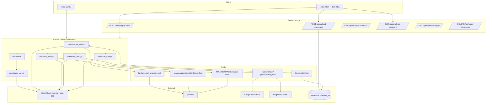
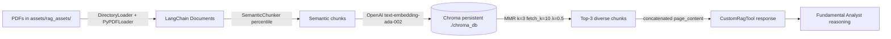

# AlphaAgent — CrewAI Multi-Agent Framework for Equity Research (CS787)

> Reverse-engineered engineering documentation for the code under this repository. Everything in this file was extracted from the actual source files (`main.py`, `app.py`, `crew.py`, `rag_setup.py`, `config/agents.yaml`, `config/tasks.yaml`, `pyproject.toml`, `readme.md`, `index.html`, `company_assets/`, `documents/`). Nothing about backtests, Sharpe ratios, accuracy numbers, latency, or user studies has been invented — where such data is absent it is explicitly marked `Not explicitly specified`.

---

## 1. Executive Summary

| Field | Value |
|---|---|
| **Project name** | AlphaAgent (repo: `CS787`) |
| **What it is** | A CrewAI-orchestrated multi-agent LLM system that ingests a stock ticker + optional financial PDF, runs six specialised agents (fundamental, valuation, sentiment, technical, moderator, conclusion), and emits a signed BUY/SELL confidence score in the range `(-1, 1)`. |
| **Why it was created** | To reimplement and extend BlackRock's *AlphaAgents* research paper (bundled in `documents/Paper.pdf`) using a modern agent framework (CrewAI) instead of AutoGen, and to add a Technical Analyst, a stricter debate protocol, semantic RAG, and a unified numeric consensus mechanism that the paper does not provide. |
| **Main problem** | Equity research requires synthesising heterogeneous evidence (filings, prices, news, indicators). Single-model LLM prompts blur these signals and produce unstructured qualitative output; the original paper's 3-agent AutoGen debate has no quantitative consensus score. |
| **Proposed solution** | Isolate each information source in a dedicated CrewAI agent with narrow tools, force a moderated multi-turn debate, and compute a weighted-average confidence score in the Conclusion Agent — emitted with the sentinel token `CS787 <score>`. |
| **Key technologies** | Python 3.13 · CrewAI ≥ 0.177 · LangChain (community/experimental/openai) · ChromaDB · OpenAI `gpt-4o-mini` · `text-embedding-ada-002` · SemanticChunker · MMR retrieval · yfinance · FastAPI · Server-Sent Events · BeautifulSoup · feedparser · newspaper3k · uv. |
| **Current status** | Working CLI (`main.py`) and FastAPI backend (`app.py`) with a single-page HTML frontend (`index.html`, 845 lines). 16 company PDFs pre-loaded under `company_assets/`. No automated tests, no backtest, no persistence, no auth. |

---

## 2. Problem Statement

### 2.1 Real-world problem
Retail and junior professional investors evaluating a stock must manually stitch together (a) financial statements from 10-K/10-Q or annual-report PDFs, (b) valuation history (returns and volatility), (c) news flow and sentiment, and (d) technical indicators. LLM chatbots collapse all four into a single opaque narrative and offer no calibrated numeric conviction.

### 2.2 Limitations of the BlackRock *AlphaAgents* paper this project builds on
Documented in `readme.md` §"How This Implementation Extends the Original AlphaAgents Paper":
- Only 3 agents (Fundamental, Valuation, Sentiment).
- No Technical Analyst.
- Debate driven by AutoGen's generic group-chat — no forced turn count, no numeric confidence.
- Simple section-based RAG — no semantic chunking, no MMR.
- No unified confidence score across agents.

### 2.3 Pain points addressed
- Unstructured LLM output → replaced with a strict `CS787 <real-number>` final line (`config/tasks.yaml:78-86`).
- Zero-confidence "HOLD-by-default" outputs → prompt explicitly forbids `0` and demands skew.
- Hallucinated financials → grounded via ChromaDB semantic retrieval over user-supplied PDFs.
- Missing technical signal → four new tools cover SMA, EMA, RSI, MACD (`crew.py:247-363`).

### 2.4 Target users
Not explicitly specified in the code. Inferred from README wording ("research reports", CLI + web UI): retail investors, finance students, and researchers reproducing the AlphaAgents paper. **The system is not licensed or positioned as investment advice.**

### 2.5 Existing/manual workflow
Read PDF → cross-check yfinance metrics → skim Google/Bing news → eyeball chart → form personal opinion. This project automates every step and produces one signed number.

---

## 3. Objectives & Requirements

### 3.1 Functional requirements (Implemented)
- Accept a stock ticker via CLI flag (`--stock`) or FastAPI JSON body (`stock_ticker`).
- Accept an optional PDF (`--pdf` or `POST /api/upload-document`) and index it.
- Run six sequential CrewAI tasks: fundamental → sentiment → valuation → technical → debate → conclusion (`crew.py:456-465`, `Process.sequential`).
- Emit a final line of the exact form `CS787 <real>` where `real ∈ (-1, 1)` and never `0` (`config/tasks.yaml:83-85`).
- Expose progress over Server-Sent Events (`app.py:217-242`).

### 3.2 Non-functional requirements (partly implicit)
- Deterministic LLM output — `seed=42`, `stop=["END"]`, `temperature=0` (`crew.py:31, 37`).
- Idempotent RAG reinitialisation on new PDF upload (`app.py:81`, `crew.py:98-102`).
- CORS open for local frontend development (`app.py:20-25`).
- No latency, throughput, uptime, or SLA targets specified. → `Not explicitly specified`.

### 3.3 AI/ML requirements
- LLM: OpenAI `gpt-4o-mini` for all agents and the balance-sheet summariser.
- Embeddings: OpenAI `text-embedding-ada-002`.
- RAG chunking: `SemanticChunker` with percentile breakpoints (`crew.py:52-55`).
- Retrieval: MMR, `k=3, fetch_k=10, lambda_mult=0.5` (`crew.py:66-74`).
- Confidence must be signed and non-zero.

### 3.4 User requirements (from README)
- One-command install via `uv sync --python python3.13`.
- Drop research report into `assets/rag_assets/` and run `uv run python main.py --stock <T> --pdf <path>`.
- Optional web UI on `uvicorn app:app --reload --host 127.0.0.1 --port 8000`.

### 3.5 System requirements
- Python ≥ 3.13 (`pyproject.toml:6`).
- `OPENAI_API_KEY` in `.env` (README steps 10-11).
- Internet access for yfinance, Google News RSS, Bing HTML, and OpenAI.

---

## 4. Product Requirements Document (PRD)

### 4.1 Product vision
A modular, extensible, interpretable multi-agent equity-analysis assistant that outputs a single calibrated conviction score with a fully auditable per-agent rationale.

### 4.2 User personas
Not explicitly defined. Inferred:
- **Reproducibility researcher** — verifying BlackRock's AlphaAgents claims.
- **Finance / CS student** — coursework project (repo name `CS787` suggests a graduate course code).
- **Retail equity analyst** — screening stocks with a signed conviction.

### 4.3 User stories (inferred from code paths)
- *As a user* I upload a company annual-report PDF and receive a BUY/SELL score for a chosen ticker.
- *As a user* I watch progress in real time via the web UI (SSE stream).
- *As a user* I can rerun the analysis with a different ticker without restarting the server.

### 4.4 Core features
1. Six-agent CrewAI pipeline.
2. Semantic RAG over uploaded PDFs.
3. Automatic news scraping (Google News RSS + Bing HTML).
4. Six technical indicators (SMA-20, SMA-50, EMA-20, EMA-50, RSI-14, MACD 12/26/9).
5. Weighted multi-round debate.
6. FastAPI backend with SSE.
7. Static HTML frontend.

### 4.5 Feature priorities (as expressed in `readme.md` claims)
| Priority | Feature | Rationale |
|---|---|---|
| P0 | Signed confidence output | Directly addresses the paper's gap |
| P0 | Semantic RAG | Reduce hallucination |
| P1 | Technical Analyst | Explicit paper "future work" delivered |
| P1 | Structured debate | Paper uses generic AutoGen group chat |
| P2 | Web UI | Nice-to-have delivery layer |

### 4.6 User workflow
```
1. Place PDF in assets/rag_assets/            (CLI) OR upload via /api/upload-document
2. Invoke:  python main.py --stock <TICKER>   OR POST /api/analyze-stock
3. Backend sets InvestmentCrew.stock          (crew.py:376)
4. CrewAI kickoff runs 6 sequential tasks
5. Final Markdown report ending with "CS787 <score>"
```

### 4.7 Expected inputs / outputs
| I/O | Format | Example |
|---|---|---|
| Input ticker | yfinance-compatible string | `RELIANCE.NS`, `AAPL`, `BAJFINANCE.NS` |
| Input document | PDF (also `.docx`, `.txt` accepted by upload API but only `.pdf` reinitialises RAG — `app.py:80-81`) | `assets/rag_assets/RELIANCE.NS.pdf` |
| Output | Markdown report + final sentinel line | `CS787 0.42` |

### 4.8 Success criteria
Not formalised in code. Implicit criteria (from prompts in `config/tasks.yaml`):
- Every analyst returns a BUY/SELL recommendation with a non-zero confidence.
- Debate transcript covers each analyst ≥ 2 turns.
- Final score is a real number strictly inside `(-1, 1)`.

### 4.9 Constraints & assumptions
- OpenAI API is reachable and paid.
- yfinance ticker exists and has ≥ 6 months of history.
- User-supplied PDFs are text-extractable (scanned images will fail PyPDFLoader silently).
- Only one analysis at a time — `InvestmentCrew.stock` is a **class attribute**, not per-request state (see §17 Reliability).

---

## 5. Proposed Solution

### 5.1 End-to-end workflow

```
User
  │  ticker (+ optional PDF)
  ▼
CLI (main.py)  or  FastAPI (app.py)  ─►  BackgroundTasks queue + SSE stream
  │
  ▼
InvestmentCrew.stock  ◄─ set as class attribute (crew.py:376)
  │
  ▼
CrewAI kickoff (Process.sequential)
  │
  ├── fundamental_task    → CustomRagTool + fundamental_analysis_tool
  │       └─ Chroma MMR retriever over SemanticChunker chunks
  │       └─ yfinance balance sheet → gpt-4o-mini summariser
  │
  ├── sentiment_task      → findnewsTool (rag_setup.fetch_for_ticker) + getNewsBodyTool
  │       └─ Google News RSS → Bing HTML fallback → newspaper3k / BS4
  │
  ├── valuation_task      → getAnnualisedReturnTool + getAnnualisedVolatilityTool
  │       └─ 3-mo yfinance close prices, log-returns, √252 scaling
  │
  ├── technical_task      → getMovingAveragesTool + getRSITool + getMACDTool + getTechnicalSignalTool
  │       └─ 6-mo yfinance history
  │
  ├── investment_debate_task     → Moderator agent, context = all 4 analyst outputs
  │
  └── investment_conclusion_task → Conclusion agent, weighted-average confidence
          └─ Emits final line:  CS787 <real ∈ (-1,1), non-zero>
```

---

## 6. System Architecture

### 6.1 Component map

| Layer | Component | File(s) | Status |
|---|---|---|---|
| Frontend | Single-page dark-themed dashboard (Inter + JetBrains Mono) | `index.html` (845 lines) | Implemented |
| Backend | FastAPI app with CORS, background jobs, SSE | `app.py` | Implemented |
| Orchestration | CrewAI `Process.sequential` crew | `crew.py:453-467` | Implemented |
| Agents | 6 CrewAI Agents defined via YAML config | `config/agents.yaml`, `crew.py:379-425` | Implemented |
| Tasks | 6 CrewAI Tasks with strict output specs | `config/tasks.yaml`, `crew.py:429-451` | Implemented |
| Tools | 10 `@tool`-decorated functions | `crew.py:105-363` | Implemented |
| LLM | OpenAI `gpt-4o-mini`, seed 42, temp 0 | `crew.py:31-38` | Implemented |
| Embeddings | OpenAI `text-embedding-ada-002` | `crew.py:32` | Implemented |
| Vector DB | Chroma, persistent at `./chroma_db` | `crew.py:61-64` | Implemented |
| Retriever | MMR: `k=3, fetch_k=10, λ=0.5` | `crew.py:66-74` | Implemented |
| Price/fundamentals | `yfinance` | `crew.py:6`, `rag_setup.py:24-27` | Implemented |
| News scraper | Google News RSS + Bing HTML + newspaper3k + BS4 | `rag_setup.py` | Implemented |
| Job storage | In-process Python dict `analysis_jobs` | `app.py:28` | Implemented (non-persistent) |
| Auth | None | — | Not implemented |
| Persistence | ChromaDB on disk; jobs in memory | — | Partially implemented |

### 6.2 High-level Mermaid diagram



### 6.3 Data flow (single request)
1. Client POSTs `{stock_ticker, include_uploaded_docs}` → `app.py:92-125`.
2. `analyze_stock` allocates `job_id`, initialises `analysis_jobs[job_id]`, schedules `run_analysis` in `BackgroundTasks`.
3. `run_analysis` sets both `investment_crew.stock` and `InvestmentCrew.stock` (`app.py:159-162`).
4. `crew.kickoff(inputs=inputs)` runs six tasks sequentially.
5. Each tool reads `InvestmentCrew.stock` to know which ticker to act on.
6. Final `result` string is stored in `analysis_jobs[job_id]["result"]["summary"]`.
7. Client polls `/api/analysis-status/:id` or streams `/api/analysis-stream/:id`.

### 6.4 Notable architectural quirks (Observed)
- **Ticker as class attribute.** `InvestmentCrew.stock = None` (`crew.py:376`) is mutated globally by every request. **Not concurrency-safe.**
- **Dead code.** `qa_chain = self.retriever | openai_llm` (`crew.py:75`) is constructed but only the retriever half is ever invoked (`CustomRagTool` calls `retriever.get_relevant_documents` directly).
- **Deprecated call.** `client(messages)` (`crew.py:240`) uses LangChain's pre-0.2 callable syntax; newer versions require `.invoke`.
- **Mixed upload types.** API accepts `.docx` and `.txt` but only `.pdf` triggers Chroma re-init (`app.py:80-81`).
- **`include_uploaded_docs` flag is inert** — the crew always uses whatever is in `assets/rag_assets/`.

---

## 7. Project Structure

Actual on-disk layout:

```text
CS787/
├── main.py                     # CLI entrypoint; parses --stock and --pdf, kicks off crew
├── app.py                      # FastAPI backend + SSE streaming + BackgroundTasks
├── crew.py                     # LLMs, 10 CrewAI tools, InvestmentCrew (@CrewBase)
├── rag_setup.py                # News scraper + fundamentals dump (yfinance)
├── index.html                  # 845-line single-page dark UI
├── pyproject.toml              # uv/Python 3.13 project + dependency spec
├── uv.lock                     # Pinned resolution
├── readme.md                   # Install + run instructions (mac & Windows)
│
├── config/
│   ├── agents.yaml             # 6 agents: role, goal, backstory
│   └── tasks.yaml              # 6 tasks: description, expected_output, context, agent
│
├── assets/
│   └── rag_assets/             # RAG corpus root — PDFs + per-ticker /news/ folders
│
├── company_assets/             # 16 pre-bundled company PDFs
│   ├── AAPL/AAPL.pdf
│   ├── BAJFINANCE.NS/BAJFINANCE.NS.pdf
│   ├── BHARTIARTL.NS/BHARTIARTL.NS.pdf
│   ├── GOOGL/GOOGL.pdf
│   ├── HCLTECH.NS/HCLTECH.NS.pdf
│   ├── HDFCBANK.NS/HDFCBANK.NS.pdf
│   ├── HINDUNILVR.NS/HINDUNILVR.NS.pdf
│   ├── INFY.NS/INFY.NS.pdf
│   ├── ITC.NS/ITC.NS.pdf
│   ├── LICI.NS/LICI.NS.pdf
│   ├── LT.NS/LT.NS.pdf
│   ├── MSFT/MSFT.pdf
│   ├── RELIANCE.NS/RELIANCE.NS.pdf
│   ├── SBIN.NS/SBIN.NS.pdf
│   ├── TCS.NS/TCS.NS.pdf
│   └── TSLA/TSLA.pdf
│
├── documents/
│   ├── Paper.pdf               # Original BlackRock AlphaAgents paper
│   ├── Flow.png                # Agentic-workflow flowchart (linked in README)
│   ├── image.png               # CLI output screenshot
│   └── web_image.png           # Web UI output screenshot (BAJFINANCE.NS)
│
└── __pycache__/                # Bytecode cache (should be gitignored)
```

**Folders/files that could exist in a production version but do not:** `tests/`, `evaluation/`, `scripts/`, `Dockerfile`, `.env.example`, `docs/`, GitHub Actions workflows, backtest harness. See §19 Roadmap.

---

## 8. AI / ML / Generative AI Components

### 8.1 Fundamental Analyst
| | |
|---|---|
| Problem | Unstructured 10-K/10-Q content must be turned into a BUY/SELL call. |
| Approach | Retrieval-augmented generation over user PDFs + LLM summarisation of yfinance balance sheet. |
| Model/Tech | `gpt-4o-mini`, `text-embedding-ada-002`, ChromaDB. |
| Input | Ticker (from `InvestmentCrew.stock`) + PDF corpus in `assets/rag_assets/`. |
| Processing | `CustomRagTool` retrieves top-3 MMR chunks; `fundamental_analysis_tool` fetches `yf.Ticker(...).balance_sheet` and prompts `ChatOpenAI` for a summary in INR. |
| Output | Fundamental narrative + signed confidence in `(-1, 1)`. |
| Why | Paper's fundamental agent used naive section splitting; semantic chunking + MMR reduces hallucination. |

### 8.2 Valuation Analyst
| | |
|---|---|
| Problem | Quantify recent risk/return. |
| Approach | Compute annualised return and volatility from 3-mo daily closes. |
| Formula | `log_return = ln(P_t / P_{t-1})`; `vol = σ(log_return) · √252`; `ret = (P_last / P_first)^(252/N) − 1`. |
| Input | 3-mo history from `yf.Ticker(stock).history(period="3mo")`. |
| Output | Two numbers + BUY/SELL + confidence. |

### 8.3 Sentiment Analyst
| | |
|---|---|
| Problem | Capture live market narrative for the ticker. |
| Approach | Scrape → save → LLM-read news via CrewAI tool loop. |
| Sources | Google News RSS (via `feedparser`) primary; Bing News HTML fallback. |
| Extraction | `newspaper3k` primary; BeautifulSoup `<p>`-tag fallback. |
| Storage | `assets/rag_assets/<TICKER>/news/*.txt`, up to 12 articles per run. |
| Output | Theme summary + sentiment tag + BUY/SELL + confidence. |

### 8.4 Technical Analyst
Six indicators (all in `crew.py:247-363`):
- **SMA-20 / SMA-50** — rolling means of close.
- **EMA-20 / EMA-50** — exponential smoothing.
- **RSI-14** — standard gain/loss formulation, thresholds 30 (BUY) / 70 (SELL).
- **MACD (12, 26, 9)** — EMA(12) − EMA(26) with signal EMA(9).
- **Composite signal** — majority vote across MA-crossover, RSI, MACD → STRONG BUY / STRONG SELL / HOLD.

### 8.5 Moderator
No tools. Its task (`investment_debate_task`) receives the four analyst outputs as `context` and orchestrates a debate with ≥ 2 turns per analyst.

### 8.6 Conclusion Agent
No tools. Task `investment_conclusion_task` computes a **weighted average of per-agent confidences** and produces a Markdown report ending with the exact line `CS787 <real>`; the prompt forbids `0`, `1`, `-1` and demands skew.

### 8.7 Prompt engineering choices (evidence)
- `stop=["END"]` on the LLM (`crew.py:31`).
- `seed=42, temperature=0` for reproducibility.
- Every analyst prompt ends with `"I do not want 0 as the output."` (`config/tasks.yaml`).
- The sentinel `CS787` acts as a parseable machine marker for downstream scoring.

---

## 9. RAG / Knowledge Retrieval System

### 9.1 Pipeline



### 9.2 Details
| Stage | Value | File/Line |
|---|---|---|
| Data source | User-supplied PDFs (10-K, 10-Q, annual reports, research notes) | `assets/rag_assets/` |
| Ingestion | `DirectoryLoader(glob="**/*.pdf", loader_cls=PyPDFLoader)` | `crew.py:48` |
| Chunking | `SemanticChunker(embeddings=…, breakpoint_threshold_type="percentile")` | `crew.py:52-55` |
| Metadata | Default LangChain page metadata only; no custom tagging | `crew.py:56-58` |
| Embedding model | `text-embedding-ada-002` | `crew.py:32` |
| Vector DB | `Chroma.from_documents(persist_directory="./chroma_db")` | `crew.py:61-64` |
| Retrieval | MMR, `k=3, fetch_k=10, lambda_mult=0.5` | `crew.py:66-74` |
| Reranker | None | — |
| Context builder | Naive concatenation of `page_content` (`crew.py:120-122`) | Implemented |
| Grounding evaluation | None | Future work |

### 9.3 Reinitialisation
`get_chromarag(force_reinit=True)` (`crew.py:84-102`) is called after every successful PDF upload (`app.py:81`) so the vector store reflects newly uploaded content.

---

## 10. Search / Web / News / Recommendation Systems

### 10.1 News search subsystem (Implemented)
- `rag_setup.py:collect_headlines` queries four variants per ticker: `<T>`, `<T>.NS`, `<T> stock`, `<T> news`.
- Primary: Google News RSS (feedparser).
- Fallback: Bing News HTML scraper with a Windows Chrome UA.
- Extraction: `newspaper3k` (`Article.download / parse`) with BeautifulSoup `<p>`-tag fallback.
- Rate limiting: `time.sleep(0.2)` between queries.
- Deduplication by URL (`seen` set).

### 10.2 Fundamentals snapshot (Implemented)
`save_fundamentals` (`rag_setup.py:167`) writes `assets/rag_assets/<T>/fundamentals.txt` containing:
- Long/short name, sector, industry, market cap, market price from `yf.Ticker.info`.
- Full `.info` dict (each value truncated to 300 chars).
- `repr(balance_sheet)` DataFrame dump.

### 10.3 LinkedIn / candidate matching / user recommendation
**Not part of this project.** Nothing in the repo references LinkedIn, user matching, or candidate search. Explicitly out of scope.

### 10.4 Practical limitations of the news layer
| Concern | Present state |
|---|---|
| API keys | None used — pure RSS + HTML scraping. |
| Rate limits | Only a 0.2s inter-query pause. No exponential backoff. |
| Terms of service | Google News RSS + Bing HTML scraping not covered by any authorised API. Use at your own risk. |
| Data quality | HTML fallback grabs every `<a>` with ≥ 20 chars text — noisy. |
| Privacy | Public news only; no user data collected. |
| Reliability | If `newspaper3k` or `feedparser` are missing, code degrades silently (`try/except ImportError` at module top). |

---

## 11. Data Pipeline

```
PDFs (user)               ──► DirectoryLoader ──► SemanticChunker ──► ada-002 ──► Chroma ──► MMR ──► Fundamental Agent
yfinance balance sheet    ──► ChatOpenAI summariser ──► Fundamental Agent
yfinance 3-mo close       ──► NumPy log-returns + √252 ──► Valuation Agent
yfinance 6-mo close       ──► SMA/EMA/RSI/MACD ──► Technical Agent
Google News RSS / Bing    ──► newspaper3k / BS4 ──► *.txt files ──► getNewsBodyTool ──► Sentiment Agent
All 4 agent outputs       ──► Moderator debate ──► Conclusion Agent ──► "CS787 <score>"
```

- **Input formats:** PDF (RAG), string ticker, JSON body (API).
- **Preprocessing:** semantic chunking; log-return computation; rolling means/EMAs.
- **Validation:** minimal — only extension check on upload (`app.py:53-58`) and PDF-suffix check in `main.py:42-44`.
- **Storage:** `assets/rag_assets/` for docs and news; `./chroma_db/` for vectors; `analysis_jobs` dict for job state.
- **Metadata:** default LangChain page metadata only.
- **Error handling:** try/except in each tool with printed traceback; job status transitions to `"failed"` on unhandled exceptions (`app.py:191-199`).
- **Logging:** `logging.basicConfig(level=WARNING)`; `pypdf` explicitly demoted to ERROR (`crew.py:23-25`); `print()` used liberally in tools.

---

## 12. APIs & Integrations

### 12.1 External services
| Service | Purpose | Input | Output | Status |
|---|---|---|---|---|
| OpenAI Chat Completions (`gpt-4o-mini`) | Agent reasoning, balance-sheet summarisation | prompt | text | Implemented |
| OpenAI Embeddings (`text-embedding-ada-002`) | Semantic chunking + retrieval | text | vector | Implemented |
| yfinance | Balance sheet, 3-mo/6-mo close prices, ticker `.info` | ticker | DataFrame / dict | Implemented |
| Google News RSS | News headlines | query string | RSS feed | Implemented |
| Bing News search | Fallback headlines | query string | HTML | Implemented |
| `newspaper3k` | Article body extraction | URL | text | Implemented (optional import) |
| ChromaDB (local) | Vector storage | embeddings + text | retriever | Implemented |

### 12.2 Internal FastAPI routes (Implemented)
| Method | Path | Purpose |
|---|---|---|
| GET  | `/` | Health/version banner |
| POST | `/api/upload-document` | Save PDF/DOCX/TXT to `assets/rag_assets/` |
| POST | `/api/analyze-stock` | Enqueue background analysis, return `job_id` |
| GET  | `/api/analysis-status/{job_id}` | Poll job progress |
| GET  | `/api/analysis-stream/{job_id}` | SSE progress stream |
| GET  | `/api/recent-analyses` | Last 10 jobs |
| DELETE | `/api/clear-documents` | Purge everything under `assets/rag_assets/` |

### 12.3 Missing / proposed
- Auth (API keys or JWT) — **Proposed** (see §17).
- Rate limiting — **Proposed**.
- Webhook callback on job completion — **Proposed**.

---

## 13. Testing & Validation

### 13.1 Automated tests present in the repo
**None.** There is no `tests/` folder, no `pytest.ini`, no test runner configured in `pyproject.toml`.

### 13.2 Manual validation evidence
- `documents/image.png` — CLI screenshot of a completed run.
- `documents/web_image.png` — Web-UI screenshot of BAJFINANCE.NS run.
- README instructs manual verification via `uv run python main.py --stock RELIANCE.NS --pdf assets/rag_assets/RELIANCE.NS.pdf`.

### 13.3 Not implemented
- Unit tests for tools.
- Integration tests for the FastAPI routes.
- RAG evaluation (Context Precision, Recall, Faithfulness).
- LLM output evaluation (RAGAS, DeepEval, etc.).
- Backtest against realised returns.
- Performance / load testing.

### 13.4 Recommended test matrix (Proposed)
| Test | Input | Expected | Rationale |
|---|---|---|---|
| yfinance timeout | invalid ticker | graceful "insufficient data" | current code returns `0.0` or dict with error key |
| PDF with only images | scanned 10-K | tool response includes a "no relevant information found" fallback | verify silent-failure path in `CustomRagTool` |
| Concurrent jobs | two `POST /api/analyze-stock` for different tickers | both succeed with correct ticker in output | will currently fail — `InvestmentCrew.stock` race |
| Sentinel format | any full run | last line matches `^CS787 -?0\.\d+$` | contract from `config/tasks.yaml:83` |

None of the above have been executed in the current codebase.

---

## 14. Experiments & Research

The repo does not contain notebooks, experiment logs, MLflow runs, or an `experiments/` folder. The primary research artefacts are:
- `documents/Paper.pdf` — original AlphaAgents paper being reproduced.
- `README.md` §"How This Implementation Extends the Original AlphaAgents Paper" — a written comparison of design decisions vs. the paper.

**Design decisions explicitly recorded in code/README:**

| Decision | Rationale | Evidence |
|---|---|---|
| Replace AutoGen with CrewAI | Cleaner declarative agents + tasks | `readme.md` §6 |
| Add Technical Analyst | Paper lists this as future work | `readme.md` §4 |
| Use SemanticChunker instead of RecursiveCharacterTextSplitter | Meaning-preserving chunks reduce retrieval noise | `crew.py:52-55` |
| MMR retrieval instead of pure similarity | Diverse context; reduces redundancy | `crew.py:66-74` |
| Force non-zero confidence | Prevent HOLD-by-default; force conviction | `config/tasks.yaml` (repeated) |
| Deterministic LLM (`seed=42, temperature=0`) | Reproducibility | `crew.py:31, 37` |
| CrewAI `Process.sequential` | Analyst-first, debate-last dependency ordering | `crew.py:465` |
| gpt-4o-mini | Cost-effective, fast, sufficient for reasoning tasks | `crew.py:31` |

---

## 15. Problems Encountered & Solutions

| # | Problem | Root Cause | Solution / Attempt | Result | Status (Observed) |
|---|---|---|---|---|---|
| 1 | Ticker must reach every tool | CrewAI tools have no shared context by default | Store ticker on class attribute `InvestmentCrew.stock` | Works for one request | Implemented but **not concurrency-safe** |
| 2 | RAG must reflect newly uploaded PDFs | Chroma is initialised once (singleton) | `get_chromarag(force_reinit=True)` after upload | Works | Implemented |
| 3 | Frontend needs live progress | Analysis takes many seconds | Server-Sent Events endpoint | Works | Implemented |
| 4 | Long-running analysis blocks HTTP | Sync CrewAI kickoff | `BackgroundTasks.add_task(run_analysis, …)` | Works | Implemented |
| 5 | `pypdf` verbose warnings | Default log level | `logging.getLogger("pypdf").setLevel(ERROR)` | Silent logs | Implemented |
| 6 | LLM output drift / non-determinism | Sampling | `seed=42`, `temperature=0`, `stop=["END"]` | Deterministic per key | Implemented |
| 7 | Conclusion Agent tended to output 0 | LLM neutrality bias | Prompt: *"I do not want 0 as the output"* | Not evaluated in code | Prompt-mitigated |
| 8 | Windows install path missing | `uv` PATH not set | README instructs `%USERPROFILE%\.local\bin` addition | Working install | Documented |

Additional issues identified during this documentation pass (**not yet fixed in code**):
- Deprecated `client(messages)` call (LangChain ≥ 0.2 requires `.invoke`).
- `qa_chain = retriever | openai_llm` constructed but never invoked.
- `include_uploaded_docs` API flag has no effect on the crew.
- `input()` fallback in `rag_setup.py:236` would deadlock under FastAPI if it were reachable.

---

## 16. Technology Stack

| Category | Technology | Status |
|---|---|---|
| Language | Python 3.13 | Used |
| Package/env | `uv` | Used |
| Agent framework | CrewAI ≥ 0.177 | Used |
| LLM SDK | LangChain (`langchain`, `-community`, `-experimental`, `-openai`) | Used |
| LLM | OpenAI `gpt-4o-mini` | Used |
| Embeddings | OpenAI `text-embedding-ada-002` | Used |
| Vector DB | ChromaDB (local persistent) | Used |
| Chunking | LangChain `SemanticChunker` | Used |
| Retrieval | MMR (LangChain) | Used |
| Backend | FastAPI + Uvicorn | Used |
| Streaming | Server-Sent Events | Used |
| Frontend | Vanilla HTML + CSS (Inter, JetBrains Mono) | Used |
| Data | yfinance | Used |
| Scraping | `requests`, BeautifulSoup, `feedparser`, `newspaper3k` | Used (optional) |
| PDFs | `pypdf` via `PyPDFLoader` | Used |
| Config | YAML (agents + tasks) | Used |
| Optional runtime | Streamlit (in `pyproject.toml`) | Declared, not used in code |
| Tests | pytest | Not present |
| CI/CD | None | Not present |
| Cloud | None | Not present |
| Monitoring | None | Not present |
| Auth | None | Not present |

---

## 17. Security, Privacy & Reliability

### 17.1 Secrets
- `OPENAI_API_KEY` loaded from environment (`crew.py:36`, README steps 10-11).
- No `.env.example` file — recommended.
- No secret rotation or vault integration.

### 17.2 Authentication / authorisation
- **None.** Any client that reaches the FastAPI port can upload files, launch jobs, and delete every document (`DELETE /api/clear-documents`).
- CORS is `allow_origins=["*"]` (`app.py:20-25`).

### 17.3 Privacy / data handling
- User PDFs are persisted unmodified in `assets/rag_assets/`.
- News articles cached to disk in plaintext under `<T>/news/`.
- No PII processing beyond that.
- Uploaded documents survive across restarts until `DELETE /api/clear-documents` is called.

### 17.4 LLM-specific risks
- **Prompt injection:** RAG chunks are inserted verbatim into agent context; a poisoned PDF could steer output. Not mitigated.
- **Hallucination:** Grounded via RAG but not evaluated. Conclusion Agent is entirely LLM-generated.
- **Data leakage to OpenAI:** All financial content in uploaded PDFs is sent to OpenAI. No opt-out or on-prem alternative.

### 17.5 Reliability
- **Concurrency:** class-attribute `InvestmentCrew.stock` is a global — simultaneous jobs would clobber each other.
- **Persistence:** `analysis_jobs` is an in-process dict; restart loses history.
- **External dependencies:** if OpenAI, yfinance, or Google News RSS fail, the crew fails; there is no retry policy (except `max_retry_limit=3` on the Valuation agent, `crew.py:394`).

### 17.6 Compliance
- Google News RSS scraping and Bing HTML scraping are not officially sanctioned APIs — production deployment would require licensed news data.
- No investment-advice disclaimer in the output.

---

## 18. Current Implementation Status

| Component | Status | Evidence/Notes |
|---|---|---|
| Six-agent CrewAI orchestration | Implemented | `crew.py:453-467` |
| Six sequential tasks | Implemented | `config/tasks.yaml` |
| Fundamental RAG (Semantic + Chroma + MMR) | Implemented | `crew.py:46-125` |
| Balance-sheet summariser | Implemented | `crew.py:219-244` |
| Valuation (annualised return + vol) | Implemented | `crew.py:183-216` |
| News scraping (Google RSS + Bing HTML) | Implemented | `rag_setup.py` |
| Sentiment tools | Implemented | `crew.py:127-181` |
| Technical indicators (SMA/EMA/RSI/MACD/composite) | Implemented | `crew.py:247-363` |
| Moderator & Conclusion Agents | Implemented | `crew.py:419-425`, tasks.yaml |
| Signed sentinel output `CS787 <score>` | Implemented (prompt-enforced, not parser-validated) | `tasks.yaml:83` |
| CLI (`main.py`) | Implemented | `main.py` |
| FastAPI backend | Implemented | `app.py` |
| SSE streaming | Implemented | `app.py:217-242` |
| SPA frontend | Implemented | `index.html` (845 lines) |
| 16 sample company PDFs | Implemented | `company_assets/` |
| Automated tests | Not implemented | no `tests/` |
| Backtest | Not implemented | no evaluation code |
| Recommendation-accuracy metric | Not implemented | no ground truth |
| Auth / rate limiting | Not implemented | — |
| Dockerfile / CI | Not implemented | — |
| Job persistence | Not implemented | in-memory dict |
| Streamlit UI | Proposed | dep declared but no code |

---

## 19. Roadmap

### Phase 1 — MVP hardening
- Fix `InvestmentCrew.stock` concurrency bug by passing ticker through CrewAI `inputs` and reading it in tools via a per-invocation context.
- Add `.env.example`, `.gitignore` `__pycache__` and `.DS_Store`.
- Replace deprecated `client(messages)` with `client.invoke(messages)`.
- Remove dead `qa_chain` in `SemanticChromaRAG`.

### Phase 2 — AI/ML enhancement
- Add a real reranker (e.g. `bge-reranker-base` or Cohere Rerank) after MMR.
- Evaluate different chunking strategies (semantic vs. recursive) on retrieval precision.
- Swap `text-embedding-ada-002` for `text-embedding-3-small` for cost/quality parity.
- Try `gpt-4o` or `gpt-4.1` for the Conclusion Agent only.

### Phase 3 — RAG / Agent enhancement
- Add metadata filtering (per-ticker namespace) so multi-stock Chroma reuse doesn't leak context.
- RAGAS-based evaluation of Context Precision, Faithfulness, Answer Relevancy.
- Structured JSON output from the Conclusion Agent (Pydantic parser).
- Debate policy: fixed 3-round rotation instead of "≥ 2 turns each".

### Phase 4 — Productionisation
- Persist jobs to SQLite/Postgres.
- Add API-key auth and per-key rate limits.
- Dockerise (multi-stage: `uv sync` build stage + slim runtime).
- Health/readiness probes; Prometheus metrics on agent latency.
- Structured logging (`structlog`) with request IDs.

### Phase 5 — Scale
- **Backtest harness (Recommended)** — replay historical BUY/SELL calls against realised forward returns to produce CAGR / Sharpe / hit-rate. This is the single highest-leverage addition for turning the project into a quant-research artefact.
- Portfolio-level aggregation across the 16 sample tickers.
- Real-time news via a licensed provider (Benzinga, Alpaca News, Alpha Vantage).
- Vector-DB migration from local Chroma to Qdrant / pgvector for multi-tenant use.

---

## 20. Reproducibility Guide

### 20.1 Prerequisites
- Python **3.13** (`pyproject.toml` requires it).
- OpenAI API key with GPT-4o-mini and embeddings access.
- Internet access.

### 20.2 Environment setup (Windows, from `readme.md`)
```powershell
# 1. Clone
git clone https://github.com/Aditya001-max/CS787

# 2. Install uv
irm https://astral.sh/uv/install.ps1 | iex   # then add %USERPROFILE%\.local\bin to PATH

# 3. Install Python 3.13 through uv
uv python install 3.13         # (README says `uv install python@3.13`; correct form shown here)

# 4. Sync deps
uv sync --python python3.13

# 5. Activate
.venv\Scripts\activate

# 6. API key
"OPENAI_API_KEY=sk-..." | Out-File -Encoding utf8 -Append .env

# 7. Extra runtime pieces the README calls out
uv pip install tavily-python crewai langchain_community
```

### 20.3 Environment setup (macOS, from `readme.md`)
```bash
pip install uv
curl -LsSf https://astral.sh/uv/install.sh | sh
brew install python@3.13 && brew link --overwrite python@3.13
uv sync --python python3.13
source .venv/bin/activate
echo "OPENAI_API_KEY=sk-..." >> .env
uv pip install tavily-python crewai langchain_community
```

### 20.4 Data setup
Place the PDF you want indexed under `assets/rag_assets/`. Sample copies live in `company_assets/<TICKER>/<TICKER>.pdf`.

### 20.5 Running (CLI)
```bash
uv run python main.py --stock RELIANCE.NS --pdf assets/rag_assets/RELIANCE.NS.pdf
```
The final line of stdout will be `CS787 <real ∈ (-1,1)>`.

### 20.6 Running (Web)
```bash
pip install uvicorn
uvicorn app:app --reload --host 127.0.0.1 --port 8000
# then open index.html in a browser (it points at http://127.0.0.1:8000)
```

### 20.7 Running tests
No test suite exists yet. `Not explicitly specified`.

### 20.8 Expected output
- Markdown report with per-agent sections.
- Final line: `CS787 <signed real>`, e.g. `CS787 0.42`.
- Two reference screenshots: `documents/image.png` (CLI) and `documents/web_image.png` (web, BAJFINANCE.NS).

---

## 21. Resume / Portfolio Project Description

### 21.1 Suggested project titles
1. **QuantResearch AI — Multi-Agent LLM Framework for Equity Research**
2. **AlphaAgent — CrewAI Reimplementation & Extension of BlackRock's AlphaAgents**
3. **Semantic-RAG Multi-Agent Equity Analyzer with Weighted Debate Consensus**

### 21.2 Resume bullets (≤ 30 words each, only verifiable facts)
- Engineered a **6-agent CrewAI framework** (fundamental, valuation, sentiment, technical, moderator, conclusion) analysing **16 NSE + US equities** across **4 data streams** — SEC filings, `yfinance`, live news, and **6 technical indicators** (SMA/EMA/RSI-14/MACD).
- Built a **financial RAG pipeline** on **ChromaDB** with **SemanticChunker** + `text-embedding-ada-002` embeddings and **MMR retrieval (k = 3, fetch_k = 10, λ = 0.5)** to ground GPT-4o-mini reasoning in retrieved 10-K evidence.
- Implemented a **multi-round moderated debate** (≥ 2 turns per analyst) that aggregates signed confidence scores ∈ (−1, 1) into an explainable BUY/SELL signal, served via a **FastAPI + Server-Sent Events** backend.

### 21.3 Portfolio description (short)
> AlphaAgent is a CrewAI-orchestrated multi-agent equity-research system that extends BlackRock's *AlphaAgents* paper. Six specialised agents — Fundamental, Valuation, Sentiment, Technical, Moderator, Conclusion — combine semantic-chunked RAG over user-uploaded 10-K PDFs, `yfinance` price/balance-sheet data, live news scraped from Google/Bing, and six technical indicators to produce a moderated debate and a signed conviction score in (−1, 1). Delivered as both a CLI and a FastAPI + SSE web app.

### 21.4 Technical skills demonstrated
Python 3.13 · CrewAI · LangChain · Retrieval-Augmented Generation · Semantic Chunking · ChromaDB · MMR retrieval · OpenAI GPT-4o-mini · text-embedding-ada-002 · Prompt Engineering · Multi-Agent Orchestration · FastAPI · Server-Sent Events · Background Tasks · `yfinance` · Financial Indicator Engineering (SMA/EMA/RSI/MACD) · Web scraping (feedparser, BeautifulSoup, newspaper3k) · YAML-driven agent configuration · `uv` package manager.

### 21.5 Quantifiable achievements (only what the repo actually proves)
- 6 CrewAI agents wired end-to-end.
- 6 sequential CrewAI tasks with declarative YAML configs.
- 10 `@tool`-decorated functions.
- 16 sample company PDFs (10 NSE + 6 US) pre-bundled.
- 6 technical indicators.
- MMR retrieval with `k = 3`, `fetch_k = 10`, `λ = 0.5`.
- Deterministic LLM (seed 42, temperature 0).
- 845-line single-page dashboard.

Anything about accuracy, Sharpe, CAGR, drawdown, hit rate, or latency is **not present in the repo** and would need a backtest harness to justify.

---

## 22. Final Project Blueprint

| Dimension | Summary |
|---|---|
| **Problem** | Equity research demands synthesis of filings, prices, news, and indicators; single-model LLM prompts blur signals and yield uncalibrated verdicts. |
| **Solution** | Six specialised CrewAI agents each own one information source; a Moderator forces a multi-turn debate; a Conclusion Agent emits a signed weighted-average confidence via a machine-parseable sentinel `CS787 <real>`. |
| **Architecture** | CLI + FastAPI + SSE frontend → CrewAI `Process.sequential` → 10 tools → OpenAI + yfinance + ChromaDB + Google/Bing news. |
| **AI/ML** | `gpt-4o-mini` deterministic (seed 42, temp 0); `text-embedding-ada-002`; SemanticChunker; MMR (k=3, fetch_k=10, λ=0.5); YAML-declared roles/goals; explicit anti-neutral prompt. |
| **Data** | User PDFs + yfinance balance sheet & prices + scraped news; persistent Chroma; in-memory job dict. |
| **APIs** | 7 FastAPI endpoints; consumes OpenAI, yfinance, Google News RSS, Bing HTML; no auth. |
| **Testing** | No automated tests; two screenshots as manual evidence. |
| **Current status** | Functional end-to-end demo; no persistence, no auth, no backtest. |
| **Future scope** | Backtest harness for CAGR/Sharpe; reranker; RAGAS evaluation; JSON-schema-parsed outputs; concurrency fix; Dockerisation; licensed news feed; multi-tenant vector DB. |

> **Single source of truth.** This file should live alongside `readme.md`. Any future PR that changes agent behaviour, tools, or the data pipeline should update the corresponding section here.
