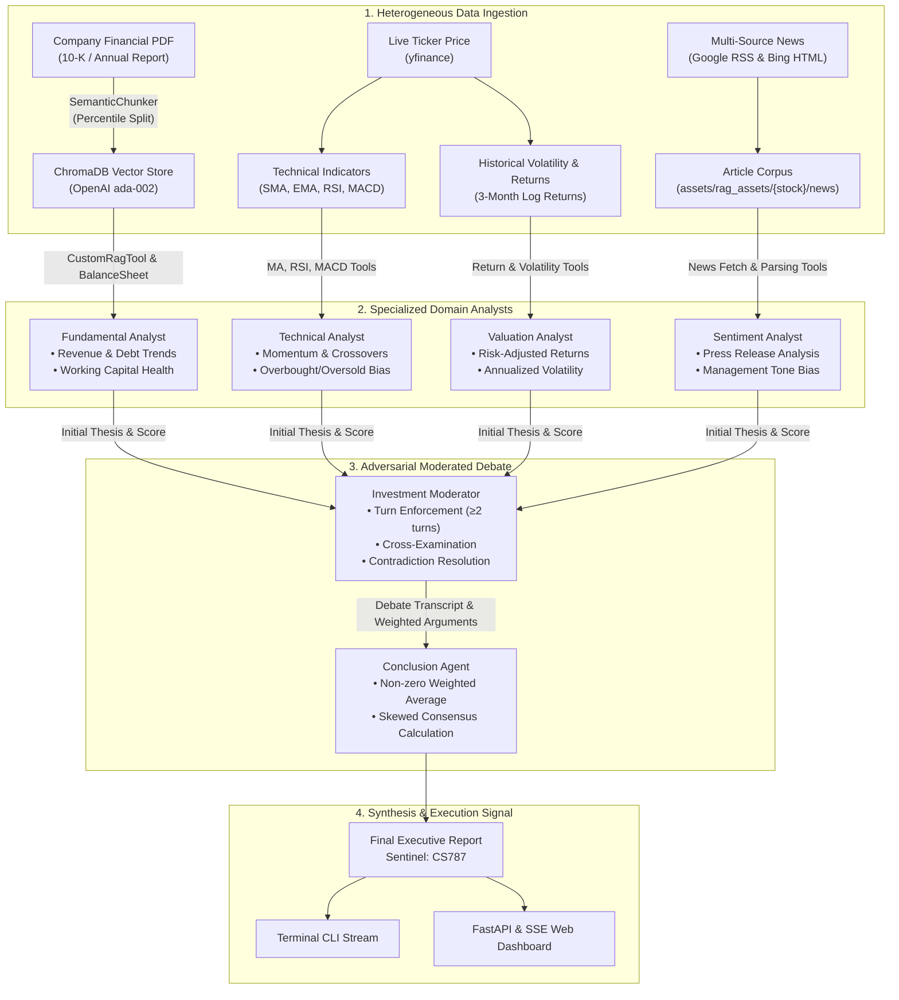
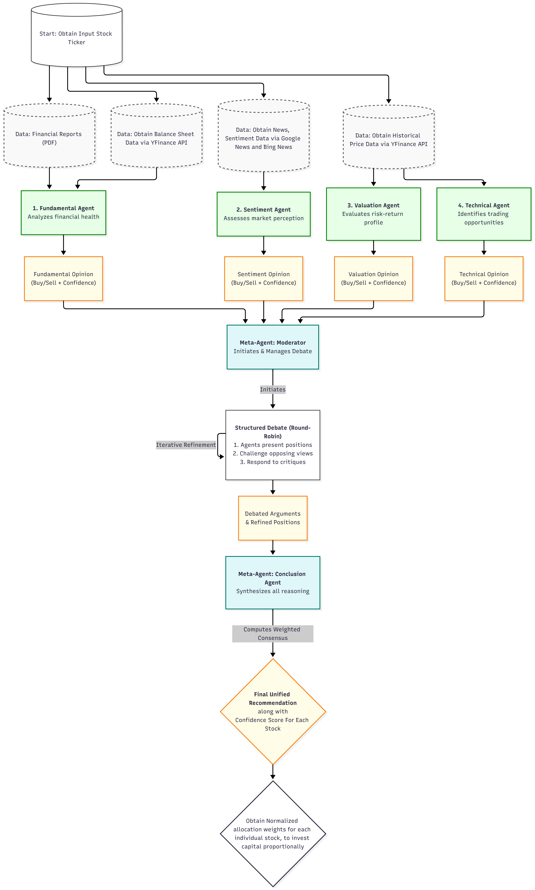
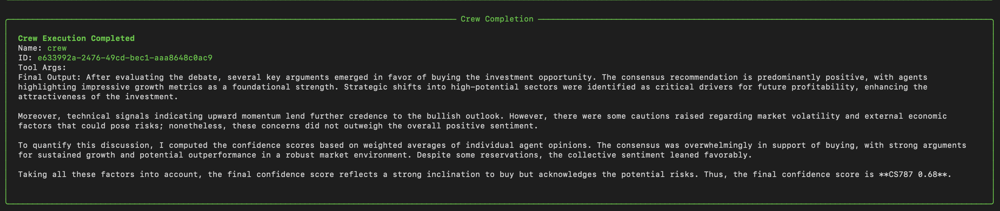
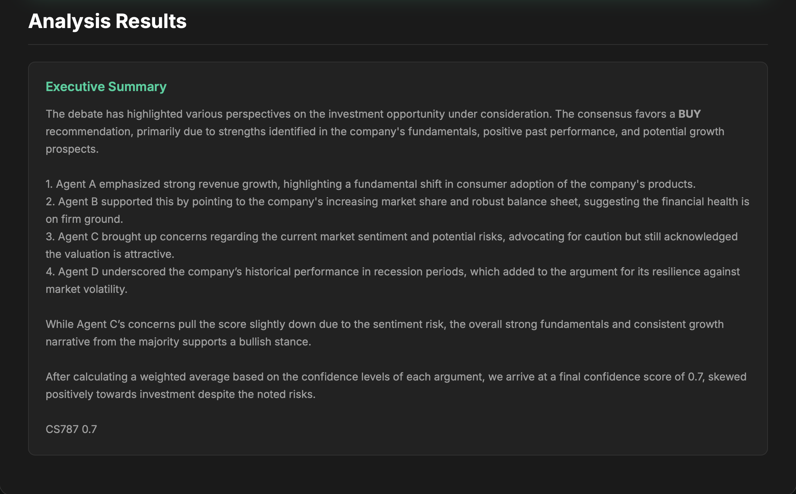

# 🚀 AlphaAgent: Autonomous Multi-Agent Equity Research & Quantitative Consensus Engine

<div align="center">

[](https://www.python.org/)
[](https://www.crewai.com/)
[](https://fastapi.tiangolo.com/)
[](https://www.langchain.com/)
[](https://www.trychroma.com/)
[](https://opensource.org/licenses/MIT)
[](https://github.com/Aditya001-max)

<p align="center">
  <strong>An enterprise-grade implementation and significant extension of BlackRock's <em>AlphaAgents</em> research paper, orchestrating a six-agent panel for financial statement extraction, valuation risk modeling, multi-channel news sentiment, technical momentum indicators, and an auditable structured investment debate.</strong>
</p>

[Key Features](#-core-capabilities--innovations) •
[Architecture](#-system-architecture) •
[Paper Comparison](#-how-this-implementation-extends-blackrocks-alphaagents) •
[Tech Stack](#-technical-stack-inventory) •
[Quickstart](#-quickstart--installation) •
[API & Web Dashboard](#-interactive-web-dashboard--api) •
[License](#-license--author)

</div>

---

## 📌 Executive Summary

**AlphaAgent** is an autonomous multi-agent financial intelligence framework that transforms unstructured financial filings, real-time market data, and sentiment streams into actionable, quantitative equity decisions. Building upon the foundational principles of BlackRock's landmark paper (*AlphaAgents: Large Language Models as Multi-Agent Investment Analysts*, [arXiv:2508.11152](https://arxiv.org/abs/2508.11152)), this system replaces brittle single-model prompting with a specialized committee of four domain analysts and two meta-governance agents operating under strict debate protocol.

The framework couples **Semantic RAG** (with percentile chunking and Maximal Marginal Relevance retrieval) with live market feeds (`yfinance`, Google News RSS, Bing News) to evaluate equities across fundamental, valuation, sentiment, and technical horizons. The debate concludes with an explicit, signed conviction score $\in (-1, 1)$ emitting a deterministic sentinel signal `CS787 <score>` representing market consensus without zero-conviction ambiguity.

---

## 🔬 How This Implementation Extends BlackRock's AlphaAgents

While the original BlackRock paper introduced a conceptual 3-agent group (Fundamental, Valuation, Sentiment) communicating via unstructured AutoGen chat, this repository delivers an enterprise-grade, production-ready system with substantial algorithmic extensions:

| Dimension | BlackRock Paper (Original) | AlphaAgent (This Implementation) |
|---|---|---|
| **Agent Roster** | 3 Agents: Fundamental, Valuation, Sentiment | **6 Agents**: Fundamental, Valuation, Sentiment, **Technical Analyst**, **Debate Moderator**, and **Conclusion Agent** |
| **Technical Analysis** | Omitted (identified as future work) | **Full Pipeline**: 20/50 SMA & EMA crossover, 14-day RSI momentum, MACD (12, 26, 9) signal line & histogram, consensus bias |
| **Orchestration Framework** | AutoGen generic group chat | **CrewAI**: Declarative tasks, strict role backstories, tool sandboxing, deterministic seeding (`seed=42`) |
| **Debate Mechanics** | Unstructured chat without minimum turn guarantees | **Structured Multi-Turn Debate**: Moderator forces argument-critique-defense loops with $\ge 2$ speaking turns per agent |
| **RAG Architecture** | Naive document sectioning | **Semantic RAG**: `SemanticChunker` with percentile breakpoints + MMR retrieval (`k=3, fetch_k=10, \lambda=0.5`) on persistent ChromaDB |
| **Consensus Mechanism** | Qualitative natural language summary | **Quantitative Non-Zero Consensus**: Weighted numeric score $\in (-1, 1)$, strictly forbidding $0.0$ hold-ambiguity; emits `CS787 <score>` |
| **Interface & Deployability** | CLI / Offline scripts | **Dual-Mode**: Robust CLI tool (`main.py`) + Asynchronous **FastAPI backend** (`app.py`) with Server-Sent Events (SSE) and glassmorphic UI (`index.html`) |

---

## 🏗 System Architecture

AlphaAgent decouples information harvesting into specialized domain agents before submitting all findings to an adversarial debate chamber.



### Visual Workflow
<div align="center">
  
</div>

---

## ⚡ Core Capabilities & Innovations

### 1. 🧠 Specialized Six-Agent Panel
- **Fundamental Analyst:** Interrogates SEC filings and financial disclosures using semantic document retrieval and balance-sheet structural analysis.
- **Valuation Analyst:** Computes annualized returns and annualized volatility over historical horizons to establish a risk-return framework.
- **Sentiment Analyst:** Scrapes, cleans, and synthesizes news feeds from Google News and Bing Search to gauge current institutional and retail sentiment.
- **Technical Analyst:** Executes automated quantitative technical scans:
  - **Moving Averages:** 20-day & 50-day SMA, 20-day & 50-day EMA crossover identification.
  - **RSI (14-period):** Overbought ($>70$) and oversold ($<30$) mean-reversion detection.
  - **MACD (12, 26, 9):** Fast/slow EMA divergence and momentum histogram direction.
- **Investment Moderator:** Enforces structured debate dynamics, ensuring every agent defends their thesis and responds to opposing signals.
- **Conclusion Agent:** Harmonizes the debate transcript, weighting analyst convictions into a signed, non-zero continuous rating.

### 2. 📚 High-Precision Semantic RAG
- **Breakpoints by Meaning:** Utilizes `langchain_experimental.text_splitter.SemanticChunker` to segment documents at natural semantic transitions rather than arbitrary token counts.
- **Maximal Marginal Relevance (MMR):** Vector similarity balanced with context diversity (`k=3, fetch_k=10, lambda_mult=0.5`) to eliminate repetitive chunks.
- **Multi-Ticker Pre-loaded Cache:** Includes 16 blue-chip enterprise reports across US and Indian equities (`company_assets/`).

### 3. ⚖️ Calibrated Consensus & Sentinel Signature
Unlike naive LLM systems that default to indecisive "HOLD" ratings, AlphaAgent's Conclusion Agent enforces conviction:
$$\text{Confidence Score } S \in (-1.0, 1.0), \quad S \neq 0.0$$
- $+1.0 \implies \text{Strong Buy}$
- $-1.0 \implies \text{Strong Sell}$
- Emits the machine-parseable sentinel: `CS787 <score>`

---

## 💻 Technical Stack Inventory

| Domain | Technology / Library | Purpose |
|---|---|---|
| **Multi-Agent Orchestration** | [CrewAI](https://www.crewai.com/) (v0.177+) | Role backstories, task workflows, sequential execution pipeline |
| **Language Models** | OpenAI `gpt-4o-mini` | High-reasoning, low-latency agent cognition (`temperature=0, seed=42`) |
| **Embeddings & Vector Store** | `text-embedding-ada-002` · [ChromaDB](https://www.trychroma.com/) | Semantic vector embeddings and persistent local vector search |
| **Document Processing** | `PyPDFLoader` · `SemanticChunker` | Meaning-preserving document parsing and chunk extraction |
| **Financial Data** | `yfinance` · `numpy` · `pandas` | Live historical OHLCV data, volatility, returns, moving averages |
| **Web Data & News** | `feedparser` · `BeautifulSoup4` · `requests` | Multi-source automated financial RSS and web page scraping |
| **API Backend** | [FastAPI](https://fastapi.tiangolo.com/) · [Uvicorn](https://www.uvicorn.org/) | Async REST endpoints, background task queue, Server-Sent Events |
| **Frontend Dashboard** | HTML5 · Vanilla CSS3 (Custom Glassmorphic) · ES6 JS | Real-time progress tracking, file drag-and-drop, dynamic report render |
| **Package Management** | `uv` / Standard `pip` | Deterministic dependency resolution and virtual environment control |

---

## 🚀 Quickstart & Installation

### Prerequisites
- Python **3.11**, **3.12**, or **3.13**
- Git
- OpenAI API Key

### 1. Clone the Repository
```bash
git clone https://github.com/Aditya001-max/QuantSearch-AI---A-Multi-Agent-LLM-Framework-for-Equity-Research.git
cd QuantSearch-AI---A-Multi-Agent-LLM-Framework-for-Equity-Research
```

### 2. Set Up Virtual Environment & Dependencies

#### Using standard Python & pip:
```bash
# Create and activate virtual environment
python -m venv .venv

# On Linux/macOS:
source .venv/bin/activate
# On Windows (PowerShell):
.venv\Scripts\Activate.ps1

# Install dependencies
pip install -r requirements.txt
```

#### Using `uv` (Fast Astral package manager):
```bash
uv sync
source .venv/bin/activate  # Or .venv\Scripts\activate on Windows
```

### 3. Configure Environment Variables
Copy `.env.example` to `.env` and set your OpenAI API key:
```bash
cp .env.example .env
```
Edit `.env`:
```env
OPENAI_API_KEY=sk-proj-yourOpenAISecretKeyHere
PORT=8000
HOST=127.0.0.1
```

---

## 🏃 Execution Modes

### Mode A: Command Line Interface (CLI)

Analyze any equity ticker. Optionally attach a research report or annual filing PDF:

```bash
# 1. Analyze an equity ticker using preloaded asset or live feeds
python main.py --stock RELIANCE.NS

# 2. Analyze with custom research report PDF
python main.py --stock AAPL --pdf company_assets/AAPL/AAPL.pdf

# 3. Analyze any US or global ticker
python main.py --stock MSFT --pdf company_assets/MSFT/MSFT.pdf
```

#### Sample CLI Output:
<div align="center">
  
</div>

---

### Mode B: Interactive Web Dashboard & REST API

Launch the FastAPI backend server:

```bash
uvicorn app:app --reload --host 127.0.0.1 --port 8000
```

Once running:
- **Interactive Web Dashboard:** Open [http://127.0.0.1:8000/](http://127.0.0.1:8000/) directly in your browser.
- **Interactive Swagger API Docs:** Open [http://127.0.0.1:8000/docs](http://127.0.0.1:8000/docs).
- **Health Check:** `GET http://127.0.0.1:8000/api/health`

#### Web Dashboard Interface:
<div align="center">
  
</div>

#### REST API Endpoints:
| Method | Endpoint | Description |
|---|---|---|
| `GET` | `/` | Serves the interactive dashboard (`index.html`) |
| `GET` | `/api/health` | Service health status check |
| `POST` | `/api/upload-document` | Upload financial PDF/document for ChromaDB vector indexing |
| `POST` | `/api/analyze-stock` | Dispatch asynchronous multi-agent equity analysis job |
| `GET` | `/api/analysis-status/{job_id}` | Poll current analysis job progress and interim status |
| `GET` | `/api/analysis-stream/{job_id}` | Real-time Server-Sent Events (SSE) telemetry stream |
| `GET` | `/api/recent-analyses` | Retrieve historical analysis audit log |
| `DELETE`| `/api/clear-documents` | Flush uploaded temporary assets and cache |

---

## 📁 Repository Structure

```
CS787/
├── config/
│   ├── agents.yaml             # Agent role descriptions, goals, and backstories
│   └── tasks.yaml              # Task workflows, context linkages, and expected outputs
├── company_assets/             # Preloaded annual filings & reports (16 companies)
│   ├── AAPL/AAPL.pdf
│   ├── BAJFINANCE.NS/BAJFINANCE.NS.pdf
│   ├── GOOGL/GOOGL.pdf
│   ├── MSFT/MSFT.pdf
│   ├── RELIANCE.NS/RELIANCE.NS.pdf
│   └── ...
├── documents/
│   ├── Paper.pdf               # Original BlackRock AlphaAgents research publication
│   ├── Flow.png                # Multi-agent architectural workflow diagram
│   ├── image.png               # CLI execution visual sample
│   └── web_image.png           # Web dashboard visual sample
├── assets/
│   └── rag_assets/             # Dynamic RAG working directory
├── app.py                      # FastAPI application, background job queue & SSE
├── crew.py                     # CrewAI agent definitions, RAG pipeline & financial tools
├── main.py                     # CLI entrypoint for standalone runs
├── rag_setup.py                # Multi-channel news fetchers and document sanitizers
├── index.html                  # Glassmorphic single-page web application
├── pyproject.toml              # Modern Python packaging configuration
├── requirements.txt            # Pinned dependency requirements
├── .env.example                # Clean environment variables template
├── .gitignore                  # Production Git ignore rules
├── LICENSE                     # MIT License
└── README.md                   # Enterprise documentation
```

---

## 🛡 Security & Best Practices

- **Zero Hardcoded Secrets:** All API keys and credentials are read strictly from environment variables via `.env`.
- **Clean Git Tracking:** Artifact caches (`.DS_Store`, `__pycache__`, `chroma_db/`) and private reports are fully excluded.
- **Defensive API Calls:** Financial indicators are wrapped with robust fallbacks to handle market holidays, ticker delistings, and rate limiting gracefully.

---

## 📜 License & Author

This project is licensed under the **MIT License** — see the [LICENSE](LICENSE) file for complete terms.

**Lead Architect & Sole Contributor:**
- **Author:** [Aditya (Aditya001-max)](https://github.com/Aditya001-max)
- **Email:** [kaushikadityaraj001@gmail.com](mailto:kaushikadityaraj001@gmail.com)
- **GitHub:** [@Aditya001-max](https://github.com/Aditya001-max)

---

<div align="center">
  <sub>Built with precision for quantitative equity research and autonomous multi-agent intelligence.</sub>
</div>
